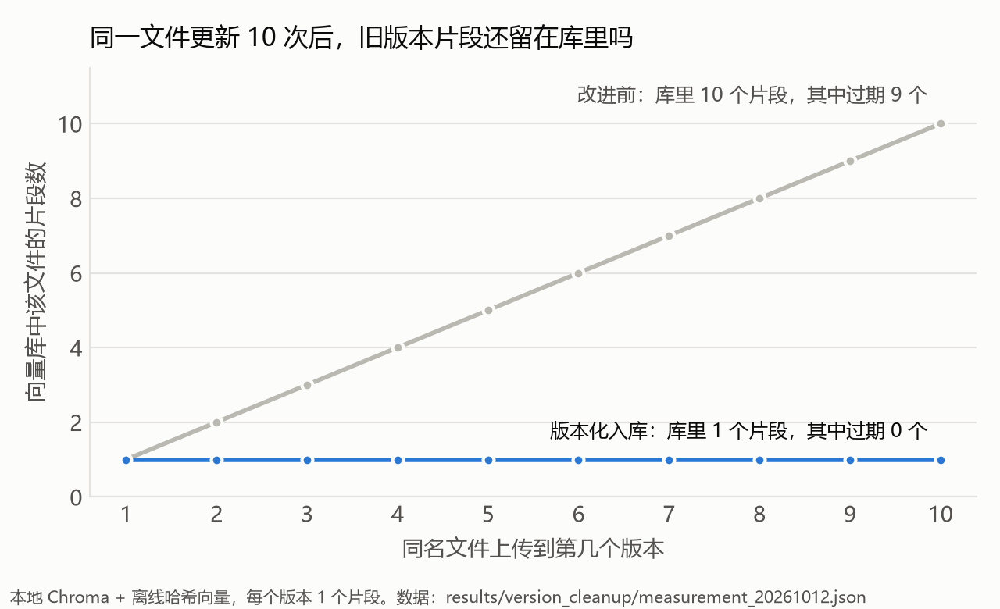
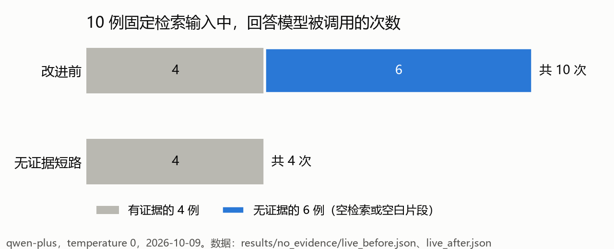

# rag-kb-versioning

**企业知识库问答：文档更新后不拿旧版本作答，没有资料就不硬答。**

一个本地 RAG 问答应用（Streamlit + Chroma + 通义千问）。这个仓库关注两个容易被忽略的问题：知识库里的文档会更新，以及检索不到证据时模型不该硬答。每个改动都配了可复现的前后对比，也记录了没解决的问题。

> 个人项目。资料和题目全部自编，规模很小，详见文末「边界」。

## 关键发现

1. **文档更新后，旧版本不能留在库里。** 同一个文件连续更新 10 次后，旧实现的向量库里留着 9 个过期片段，检索时随时可能被召回。改为「先写新版本、再清旧片段」并记录写入状态后，过期片段为 **0**。
2. **没有证据，就不该问模型。** 检索为空或只剩空白片段时，由程序直接回答「资料不足」。在 10 例固定检索输入（其中 6 例没有有效证据）上，回答模型的调用从 10 次降到 **4 次**。改进前，模型在没有证据时还会把空白片段列为引用来源。
3. **数据不支持，就不换方案。** 纯向量检索与「字符 TF-IDF + RRF」混合检索，在 20 题自建检索集上的指标完全相同（Hit@1 均为 15/16，MRR@3 均为 0.969），所以默认仍用纯向量。唯一一道 Top-1 错题，两种方式都错在同一处：问题里带了另一篇文档的关键词。
4. **「无证据」的判断还不够。** 短路只覆盖检索为空的情况。题集里 4 道没有答案的问题，检索仍各返回 3 个不相关片段，会被交给模型。下一步需要相关性阈值。



每条结论对应的真实运行记录，见 **[docs/CASES.md](docs/CASES.md)**。

## 评测怎么设计

| 实验 | 数据 | 测什么 | 模型 |
|---|---|---|---|
| 版本更新 | 同名文件依次上传 10 个版本，再重传最新版 10 次 | 库里留下几个片段、其中几个过期、重传是否重复调用 Embedding | 无：本地 Chroma + 哈希向量，断网 |
| 无证据短路 | 10 例固定检索输入：4 例空检索、2 例空白片段、4 例有效片段（`data/eval/no_evidence_cases.json`） | 回答模型被调用几次、回答了什么 | qwen-plus，temperature 0 |
| 检索对比 | 12 篇单片段短文档、20 题：16 题标注来源，4 题无答案（`data/eval/retrieval_benchmark.json`） | 文档级 Hit@k、Recall@k、MRR@3 | text-embedding-v4，向量已缓存 |

- **固定输入：** 检索题集的 SHA-256 记录在结果文件里。两种检索方式共用同一份向量缓存，排除 Embedding 波动的影响。
- **口径：** 多来源题只命中一篇，不算全部召回；无答案题不计入召回率分母，也不能用来证明系统会拒答。
- **前后对比用同一组输入。** 版本更新实验的「改进前」代码保存在 `experiments/baseline_20261012/`，可以重跑。

## 策略与结果

### 版本化入库

文件名作为文档身份，同名新内容表示替换。写向量前先登记新旧片段 ID 和 `writing` 状态；新版本全部写入后标记 `ready`，再删除旧片段。中途失败时，下次入库或检索前按日志恢复，不展示新旧混合的版本。细节见 [docs/ENGINEERING.md](docs/ENGINEERING.md)。

| 同名文件上传 10 个版本后 | 库里片段 | 其中过期 | 最新版重传 10 次新增 Embedding 调用 |
|---|---:|---:|---:|
| 改进前 | 10 | 9 | 0 |
| 版本化入库 | 1 | **0** | 0 |

重传不新增调用，是原有的去重在起作用，不是这次改动的收益。

### 无证据短路



有证据的 4 例，改进前后都正常生成，回答基本一致。接口返回的总 token 从 1723 降到 838，只是这两次运行的观测值，不代表稳定的成本降幅。这组输入是专门构造的，6/10 无证据的比例不代表真实流量。

### 检索对比：持平，不换默认

| 文档级指标（16 道有答案题） | 纯向量 | 字符 TF-IDF + RRF |
|---|---:|---:|
| Hit@1 | 15/16 | 15/16 |
| 平均 Recall@1 | 84.4% | 84.4% |
| 平均 Recall@3 | 100% | 100% |
| MRR@3 | 0.969 | 0.969 |

混合检索用字符 2–4 gram TF-IDF 召回，再用 RRF 和向量排名融合。它不是 BM25，也没有重排模型。这次指标完全持平，不能写成「混合检索提升召回」，所以页面默认仍用纯向量，混合模式只作为显式选项保留。题集较小，而且 12 篇文档各只有一个片段，区分度有限。

## 迭代过程

1. **最初版本：** 上传 → 切分 → 向量检索 → 生成 → 展示来源，加关键词评测记录。
2. **2026-10-09，无证据短路：** 对固定检索输入跑真实模型，发现检索为空时仍会调用模型，还会把空白片段当作引用（CASES 第 2 条）。于是改为先过滤空白片段，无证据时由程序作答，并补上问题和 `top_k` 的参数校验。
3. **2026-10-12，版本化入库：** 用同名文件连续更新，发现旧片段全部残留（CASES 第 1 条），原因是旧实现按内容哈希判断新文件，只追加、不删除。于是改为版本化写入和故障恢复。
4. **2026-10-12，检索对比：** 同期试了混合检索。结果持平，不换默认；同时发现两个没解决的问题：编号相近的错题（CASES 第 3 条）和无答案题仍召回不相关片段（CASES 第 4 条）。

## 下一步

- **相关性阈值或重排：** 让「检索到了但不相关」也能触发拒答。目前 4 道无答案题各召回 3 个片段。
- **引用校验：** 检查回答里的每个结论是否被引用片段支持。目前模型会做资料外的推断，还自报「可信度：高」（CASES 第 5 条）。
- **编号类问题：** 错误码、套餐编号要精确匹配，或在生成时核对编号是否一致。
- **评测：** 用真实文档、多片段文档和别人写的题，测回答正确率，而不只是检索命中；同一配置多跑几次，看结论是否稳定。

## 复现

Python 3.11+。

```bash
pip install -r requirements.txt
python -m pytest tests -q                    # 54 项离线测试，不调模型
python experiments/version_cleanup.py        # 版本更新实验，改进前后各跑一次，断网 -> results/version_cleanup/rerun.json
python experiments/retrieval_compare.py      # 用缓存向量重跑检索对比，不发请求 -> results/retrieval/rerun.json
python experiments/no_evidence.py --report   # 用已保存的运行记录重建报告，不发请求 -> results/no_evidence/report.md
pip install matplotlib && python scripts/make_charts.py   # 重画 README 里的图
```

无证据短路的生成实验需要调用模型：在环境变量里设置 `DASHSCOPE_API_KEY`，并安装 `openai`。它最多发 10 次请求，只运行当前代码，结果写入新文件，不覆盖已保存的记录：

```bash
python experiments/no_evidence.py --approved-live
```

运行问答页面：复制 `.env.example` 为 `.env` 并填入自己的 Key（或者直接设置环境变量），然后运行 `streamlit run app.py`。先上传 `data/raw/` 里的两份示例资料，再提问。入库和问答会调用 DashScope 的 Embedding 和模型接口，会产生费用。

## 目录

```text
app.py                      Streamlit 页面
src/                        入库、检索、生成、日志
data/raw/                   两份示例资料
data/eval/                  检索题集、无证据短路的固定输入、页面样例题
experiments/                三个实验脚本；baseline_20261012/ 是版本化入库之前的代码
results/retrieval/          检索对比结果与 text-embedding-v4 向量缓存（约 0.9 MB）
results/version_cleanup/    版本更新实验结果
results/no_evidence/        生成实验的运行记录（含请求用量，不含 Key）与报告
docs/CASES.md               失败样本与归因
docs/ENGINEERING.md         写入协议、日志、测试等工程细节
scripts/                    画图
tests/                      离线测试
```

## 边界

- 资料和题目都是自编的，规模很小：12 篇单片段短文档、20 道检索题、10 例生成输入。不是生产语料。题集里的开发 / 验证划分也是自己做的，不是外部盲测。
- 版本更新实验用哈希向量，只验证存储行为，不验证语义召回。版本化写入是可恢复的本地写入协议，不是跨 Chroma 和 JSON 的事务。
- 无证据短路只判断空检索和空白片段，不判断相关性，也不保证回答正确。
- 没有测回答正确率。页面的评测面板只做关键词子串匹配。
- 每个生成配置只跑了一次。
- 单用户本地应用，没有登录、权限和多租户，不适合直接开放到公网。

来源与说明见 [NOTICE](NOTICE.md)。
